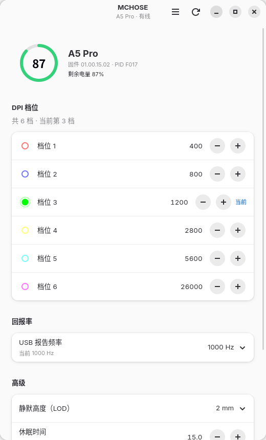
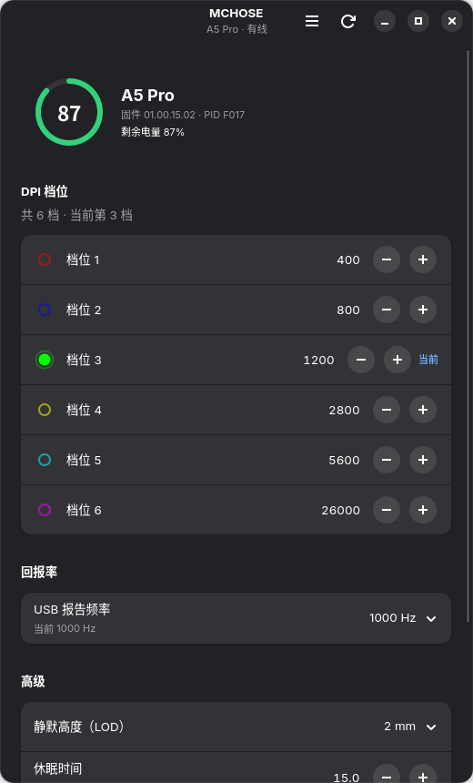

# mchose-linux — MCHOSE A5 / AX5 Pro 系列鼠标的 Linux 驱动（GNOME 扩展 + GTK 应用）

厂商驱动 `A5_AX5_Pro_ProMax_Drive_Ver2066.exe` 只有 Windows 版且早已停止更新。
本项目通过逆向该驱动，在 Linux 上原生复刻了它的核心配置功能。

**不需要 Wine，不需要内核模块，不需要 DKMS。**

## 快速安装

```bash
curl -fsSL https://github.com/wangpinglan/mchose-linux/releases/latest/download/install-mchose.sh | bash
```

仓库改名的话，这里和 `extension/metadata.json` 里的 `url` 一起改。
需要先发一次 Release（见「[发布新版本](#发布新版本)」）这条命令才有效。
首次装完要注销重登一次，详细步骤见「[安装](#安装)」。

两种用法：

| | 用途 | 位置 |
|---|---|---|
| **GNOME 扩展** | 顶栏常驻电量/DPI，点击展开完整控制面板 | `~/.local/share/gnome-shell/extensions/mchose-mouse@local/` |
| **命令行工具** | 脚本化、远程操作、排错 | `mchose.py` |

## 原理

逆向结论：这个驱动**没有用任何厂商私有协议**，走的是标准 HID Feature Report。
Windows 端通过 `HidSharp` 调 `SetFeature` / `GetFeature`，Linux 端对应
`/dev/hidraw*` 的 `HIDIOCSFEATURE` / `HIDIOCGFEATURE`，一一对应。

协议细节（报文结构、命令码表、字段偏移）见 [PROTOCOL.md](PROTOCOL.md)。

## GNOME 扩展

顶栏右侧显示 `🔋 76% · 1600`，点开是分组卡片式面板：

- 概览卡：型号 / 固件 / PID + 电量环
- DPI：六档每档都能直接输入数值（回车生效），点色点切当前档，另有对数滑块
- 回报率：型号基础列表 + 4K 接收器追加（A5 Pro 配 4K 接收器可到 4000）
- 高级：静默高度、直线修正、按键消抖、休眠时间、配置文件

```bash
bash dist/install-mchose.sh
```

详见下面「安装」一节。

## GTK 应用（libadwaita）

不想装扩展的话，也可以用桌面应用：GTK4 + libadwaita 1.x，窗口式界面，
不依赖 GNOME Shell 版本，KDE / Sway 下同样能跑（只要有 GTK4 和 libadwaita）。

<p align="center">
  
  
</p>

- 顶部概览：型号、固件、PID、有线/接收器、电量环
- DPI 六档：右侧直接改数字，点色点切当前档
- 回报率、静默高度、休眠时间、按键消抖、直线修正、配置文件 1–5
- 底部没有「保存」按钮：改完立刻写入设备，成功弹 toast

```bash
bash app/install-app.sh        # 装到 ~/.local，菜单里出现「MCHOSE 鼠标设置」
mchose-gtk                     # 或者直接命令行启动
bash app/install-app.sh --uninstall
```

依赖：`gtk4`、`libadwaita`、`python3-gobject`。Fedora 上：

```bash
sudo dnf install gtk4 libadwaita python3-gobject
```

它和扩展共用同一套协议代码（`mchose.py`）和状态组装（`mchose_api.py`），
udev 规则也是同一条 `70-mchose.rules`，装过扩展的机器直接就能用。

## 安装

### 一条命令（也能装到别的电脑）

把 `dist/install-mchose.sh`（约 45 KB）拷到目标机器，然后：

```bash
bash install-mchose.sh
```

**不要加 `sudo` 运行。** 脚本只在写 udev 规则那一步自己请求提权；
sudo 整个脚本会让 `HOME` 变成 `/root`，扩展装进 root 家目录，你的桌面会话看不到。
（脚本已做保护：检测到 `SUDO_USER` 会自动降回你的用户，但别依赖它。）

这个脚本里**内嵌了扩展本体（zip）和 udev 规则**，不联网、不需要克隆本仓库。
它会：

1. 解包到 `~/.local/share/gnome-shell/extensions/mchose-mouse@local/`
2. 装命令行工具到 `~/.local/bin/mchose`
3. 写 `/etc/udev/rules.d/70-mchose.rules`（要一次 sudo），让普通用户读写 hidraw
4. 把 uuid 加进 `enabled-extensions`

**首次安装必须注销重登** —— GNOME 只在启动时扫描扩展目录，新目录当场看不见。
在同一台机器上更新则不需要：脚本会自动 disable/enable，界面立即生效。

```bash
bash install-mchose.sh --no-udev    # 不动系统文件（没有 sudo 时）
bash install-mchose.sh --uninstall  # 卸载（配 --no-udev 则保留 udev 规则）
```

要求：GNOME 45–51、Python 3.6+、任意架构（协议与架构无关）。

### 用标准扩展包

```bash
gnome-extensions install --force dist/mchose-mouse@local.shell-extension.zip
```

它只含扩展本身，不含 udev 规则和 CLI，装完还需手动做第 3 步。

### 从源码装（本机开发用）

```bash
./install.sh                       # CLI + udev 规则
```

然后改代码、`tools/build_release.py` 打包，或直接把仓库文件放进扩展目录。

### 重新打包

```bash
python3 tools/build_release.py
```

`dist/.src` 是每次打包时从仓库自动收集的中间目录，不用手动维护。

### 发布新版本

```bash
python3 tools/build_release.py
```

然后在 GitHub 上新建 Release（tag 形如 `v1.0`），把这两个文件作为附件上传：

| 文件 | 用途 |
|---|---|
| `dist/install-mchose.sh` | 一键安装脚本，README 顶部的 `curl` 命令依赖它 |
| `dist/mchose-mouse@local.shell-extension.zip` | 标准扩展包，可 `gnome-extensions install` |

**文件名不要改**，`releases/latest/download/<文件名>` 是按名字取附件的。

## 用法

```bash
mchose list                  # 扫描设备，标出哪个节点是配置接口
mchose info                  # 固件版本、PID、当前 profile、回报率、消抖、LOD

mchose dpi                   # 读 DPI 档位（含原始字节，用于校准布局）
mchose dpi --switch 1        # 切到第 2 档
mchose polling               # 读回报率
mchose polling 4000          # 设 4000Hz
mchose sleep 15              # 15 分钟无操作休眠（下发时换算成秒）
mchose debounce 4            # 按键消抖 4ms
mchose lod 2                 # 静默高度 2mm（单位就是毫米）
mchose anglesnap on          # 开直线修正
mchose profile 2             # 切到 2 号配置文件
mchose battery               # 电量
mchose raw 2 1 0x81 0        # 发原始帧调试
```

## 支持的型号

| 型号 | 有线 PID | 无线 PID |
|------|----------|----------|
| A5 Pro | F017 | F013 |
| A5 Pro Max | F019 | F013 |
| AX5 Pro | F026 | F024 |
| AX5 Pro Max | F022 | F024 |
| A5 4K 接收器 | — | F015 |

VID 统一是 `0x2023`。配置接口的判据：HID Report Descriptor 里
Usage Page `0xFFFF`、64 字节 Feature（`06ffff 0900 a101 ... 9540 b102`），
即 Feature Report 长度 65（含 report id）。

## 状态

| 功能 | 状态 |
|------|------|
| 设备发现 / 识别配置接口 | ✅ 已实现 |
| 固件版本、PID、profile 读写 | ✅ 已实现 |
| 回报率写入 + 档位裁剪 | ✅ 已实现（型号表基础列表 + 复刻 GetGoldenDonglePollingRate 追加） |
| 回报率读取 | ✅ 已实现（出厂未设置时回 `0x00`，界面提示「还没设过」） |
| 休眠时间读写 | ✅ 已实现（单位秒，默认 900 = 15 分） |
| 按键消抖读写 | ✅ 已实现 |
| 静默高度 (LOD) 读写 | ✅ 已实现 |
| 直线修正开关 | ✅ 已实现 |
| DPI 档位读取 | ✅ 已实现（大端 16 位） |
| DPI 档位写入 | ✅ 已实现 |
| DPI 档位颜色读取 | ✅ 已实现（组2 码0x81） |
| 电量 | ✅ 已实现（组0 码0x83，`[7]`状态 `[8]`百分比） |
| 灯效 | ⚠️ 帧结构已知（组2 码0x00），未封装到 CLI |
| 按键重映射 | ⚠️ 帧结构已知（组3），未封装到 CLI |
| 宏 | ⚠️ 帧结构已知，未封装 |
| 固件升级 | ❌ 不做（风险太高，用 Windows 一次性刷完即可） |

DPI 和电量已用真机（A5 Pro + 4K 接收器，PID F017 / 接收器 F015）验证通过。
`mchose dpiprobe` 会打印原始收发帧，排查协议不符时用。

## 加新功能

`mchose.py` 里 `Mchose` 类的方法都是一行帧构造：

```python
# 读：命令码 | 0x80，参数从 [7] 开始
r = self.xfer_read(group, code, params, length=len(params))
# 写
self.xfer_write(group, code, params, length=len(params))
```

返回值 `r` 是 65 字节应答，`r[1] == 0xA1` 表示设备确认。
参数区从 `r[7]` 开始，但有些命令的应答会偏移一位（`r[8]`），
具体看 PROTOCOL.md 里每个命令的说明。

## 已知坑

- **udev 规则必须以 `70-` 开头**。`systemd` 在 `73-seat-late.rules` 里才有
  `TAG=="uaccess" ... RUN{builtin}+="uaccess"`，把标签变成 ACL；放在 `99-` 里
  标签加得太晚，规则里的 `TAG+="uaccess"` 不会生效，表现就是面板报
  「没有权限打开 /dev/hidrawN」——有线、无线切换后节点重新枚举时尤其明显。
  （旧的 `99-mchose.rules` 安装脚本会自动删掉。）
- **设备休眠时 HID 通道会断**。读不到就动一下鼠标唤醒，再试。
- 一个鼠标会枚举出 3～4 个 hidraw 节点（键盘接口、鼠标接口、Consumer 接口、
  配置接口）。只有配置接口的 Feature Report 长度是 65，`mchose list` 会标出来。
- 如果 Feature Report 写不进去，可能有别的程序占了接口 —— 关掉
  其他鼠标软件（Solaar、libratbag 等）再试。
- `libinput` / `hid-microsoft` 一般不会抢这个厂商接口，但个别内核版本
  会把未知 HID 设备当鼠标接管。真遇到了加一条 `quirks`：

  ```
  # /etc/modprobe.d/mchose.conf
  options usbhid quirks=0x2023:0xF017:0x0004
  ```

## 仓库结构

```
mchose.py                 命令行工具 + 协议实现（零依赖，仅标准库）
mchose_api.py             状态读写封装（守护进程和 GTK 应用共用）
mchose-daemon.py          常驻守护进程，扩展通过 stdin/stdout 的 JSON 与它通信
install.sh                本机开发用：装 CLI 与 udev 规则
70-mchose.rules           udev 权限规则

app/                      GTK4 + libadwaita 桌面应用
  main.py                 入口，Adw.Application
  mchose_app/window.py    主窗口与交互
  mchose_app/widgets.py   电量圆环、档位圆点（Cairo 自绘）
  mchose_app/backend.py   设备句柄与后台线程
  data/                   桌面项与多尺寸图标（由根目录 MCHOSE.png 生成）
  install-app.sh          装到 ~/.local

extension/                GNOME 扩展源码
  metadata.json
  extension.js            外壳（十几行），用带时间戳的 URL 载入 impl.js
  impl.js                 界面与交互
  daemon.js               守护进程的 GJS 客户端
  stylesheet.css

tools/
  build_release.py        打包：生成单文件安装脚本 + 标准扩展 zip
  make_icon.py            从 MCHOSE.png 生成各尺寸图标（需要 Pillow）

docs/                     截图
dist/                     打包产物（不入库，用上面脚本生成）
PROTOCOL.md               协议逆向笔记：报文结构、命令码、字段偏移
```

`extension/` 与 `mchose.py` 是唯一真相，`dist/` 全部由 `tools/build_release.py`
从它们生成，改完代码重新跑一次即可，不需要手工同步。

逆向中间产物（`extract/` 厂商安装包解包、`src/` 反编译出的 C# 源码）体积大且含
厂商二进制，放在 `.gitignore` 里不入库。查协议时看
`src/pgckyKZq6gyHNM8uTF/m4E88s4JvMgGlnhjWi.cs`，类名是厂商混淆的随机串。

## 法律说明

仅用于让自己合法拥有的硬件在 Linux 下可用。不含厂商代码，不含固件，
不绕过任何授权或许可证校验。
